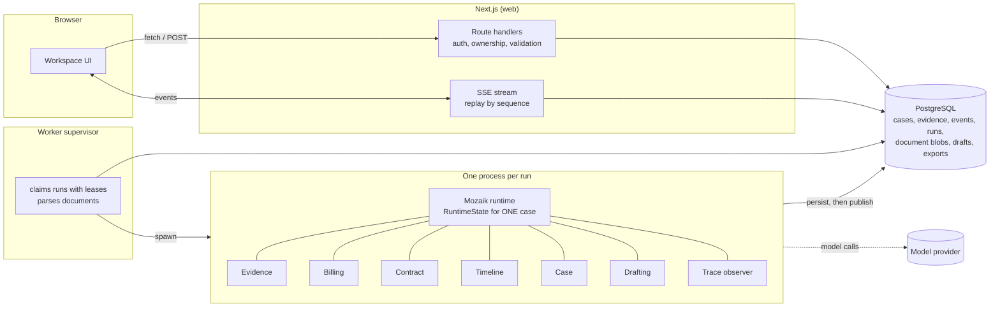

# Counterbill

**When a freight bill doesn't match the evidence, build a case you can actually send.**

Importers get freight invoices that disagree with their quote, packing list or measurements, and untangling why is slow and
easy to get wrong. Counterbill puts six [Mozaik](https://docs.jigjoy.ai/docs/runtime) agents on the documents at the same
time. They record cited facts, recalculate the difference with exact arithmetic, look for the carrier's contractual basis,
argue against the importer's own position, and draft a non-accusatory complaint letter. **When you add a document, only the
affected agents reassess, the conclusion and the letter change, and the screen tells you what changed and why.** The old
reading is kept as "superseded".

It does not give legal advice, decide who is right, guarantee refunds, or send anything. A volume difference is shown as a
*difference under review*, never as money you are owed: declared, measured, billed and chargeable volume are different things.


> *The screenshots in this README are from the real running app in **test mode** (see Status), at 1280 px and 390 px.*

## Status: what is real, what is verified, what is not

| | State |
|---|---|
| Web app, worker, database, auth, uploads, parsing, viewer, corrections, letter editor, PDF/CSV export, dashboard, settings, data deletion | Built and exercised end to end (below). |
| Six Mozaik agents running concurrently in an isolated worker process per run, with durable events, replay and bounded retries | Built. Verified by integration tests that start **real worker processes** on real PostgreSQL. |
| **A run against a real language model** | **Not performed.** No provider credential was available where this was built. See [Run it with a real model](#run-it-with-a-real-model). |
| Model calls in the automated tests | Either the labelled deterministic **test mode** runner (plugged into the same Mozaik runtime), or a local **fake of the OpenAI Responses API** that exercises Mozaik's real OpenAI adapter, strict JSON schemas and tool calling. Neither is a model. |
| Hosted deployment | **Not deployed.** A `Dockerfile` and instructions are included; it needs an account the build could not create. |
| Demo video | Not made. |

Everything the UI says about being "TEST MODE" is literal: in test mode a scripted stand-in produces the agent outputs, and the
UI, trace, evidence summary and exports say so. Test mode is never selected implicitly: with no key and no explicit flag,
starting an investigation returns a setup error.

## The sample case (and how truthful it is)

The primary sample is built from the Nigerian Shippers' Council report of 31 August 2026 about a six-package LCL shipment
(billed 1.10 CBM, packing-list estimate 0.55 CBM, surveyed 0.75 CBM, ₦542,000/CBM → ₦596,200 billed vs ₦406,500 at the
survey volume, ₦189,700 difference; the rating basis was not established). I read both cited reports from the live pages and
re-derived the arithmetic. **Read [`docs/SOURCE_VERIFICATION.md`](docs/SOURCE_VERIFICATION.md)**: it lists what matched the PRD,
what the report does not say, and what could not be verified (including a third "demurrage" sample that has no source, so it is not shipped).

- The invoice and packing list are **not published**; they are reconstructions and carry the label *"Reconstructed for demonstration; not an original invoice"* in the document list, the viewer, the findings, the letter annex and both PDFs.
- The survey document is a short source-derived excerpt of the report, labelled as such, with a link.
- An optional second step adds a **hypothetical rate sheet with a 1.00 CBM minimum**. It is *not* in the report, is labelled "Hypothetical illustration", and exists only to show how a stated term changes the analysis (the case moves to "a stated contract term may explain the billed volume; ₦54,200 remains unexplained").

## Quick start (local)

Prerequisites: Node 20+, pnpm. No Docker needed.

```bash
pnpm install
cp .env.example .env            # then set the model key (below), or COUNTERBILL_INFERENCE=test for a labelled offline run
pnpm db:start                   # embedded PostgreSQL on :54329 (leave running; or `docker compose up -d postgres`)
pnpm db:migrate                 # in a second terminal
pnpm dev                        # web on :3000 + worker supervisor
```

Open http://localhost:3000 → **Investigate a sample case**. `pnpm demo:check` reports, without calling a model, whether this machine is ready and in which mode.

### Run it with a real model

1. In `.env` set `MOZAIK_MODEL` (default `gpt-5.5`; any model Mozaik 4.2 ships: `gpt-5.x`, `claude-*`, `gemini-*`, `deepseek-*` (no structured output, so not usable here)) and the matching key: `OPENAI_API_KEY`, `ANTHROPIC_API_KEY` or `GEMINI_API_KEY`.
2. Restart `pnpm dev` (the **worker** reads the key at start).
3. Remove `COUNTERBILL_INFERENCE=test` from `.env`.

Keys are server-side only: they are never sent to the browser, stored, put in a trace or logged. A run stops after `MAX_MODEL_CALLS_PER_RUN` calls (default 24).

### Environment

| Variable | Purpose |
|---|---|
| `DATABASE_URL` | PostgreSQL 15+. Default points at the embedded dev database. |
| `MOZAIK_MODEL` | Model name. Default `gpt-5.5`. Optional `MOZAIK_REASONING_EFFORT` is passed through if set. |
| `OPENAI_API_KEY` / `ANTHROPIC_API_KEY` / `GEMINI_API_KEY` | Credential for the model's provider. |
| `COUNTERBILL_INFERENCE=test` | Explicit, labelled deterministic mode for CI and offline checks. |
| `PUBLIC_APP_URL`, `SESSION_SECRET` | Public origin and cookie secret (set a long random secret in production). |
| `MAX_CASE_DOCUMENTS`, `MAX_FILE_MB`, `MAX_CASE_MB` | Upload limits (defaults 10 / 15 / 50). |
| `MAX_AGENT_REVISIONS`, `MAX_MODEL_CALLS_PER_RUN`, `AGENT_TASK_TIMEOUT_MS` | Per-run bounds on agent passes, model calls and a single call. |
| `MAX_CONCURRENT_RUNS`, `DEMO_RUNS_PER_IP_PER_HOUR` | Worker concurrency; sample-run rate limit (bounds model spend on a public deployment). |

## Reproduce the key moment

1. Open **Sample cases → Investigate this sample case**. Four agent rows start at once; the **Activity** tab → *Concurrency view* shows their recorded start/finish times and the overlap between them.
2. The first reading: *"The packing-list estimate conflicts with the bill"*, difference ₦298,100 against a **shipper's estimate** (a comparison, not a measurement). Billing first reports its inputs as missing because it does not wait for Evidence; it recalculates when Evidence records the facts.
3. Click **Add published survey finding**. Evidence, then Billing, Contract, Timeline wake on events; the Case Agent revises: *"A survey supports a 0.35 CBM volume difference (₦189,700 at the billed rate); the contractual rating basis is unresolved."* A banner lists what changed, the earlier finding appears as **superseded**, and the letter is revised.
4. Click a citation chip (e.g. `D4-p1-s5`): the document opens at the highlighted passage.
5. **Letter** tab: edit a paragraph. Edits are saved, marked *not verified by Counterbill*, and never overwritten; later agent revisions to that paragraph arrive as a proposal with *Accept proposed update / Keep my wording*.
6. Tick the review acknowledgement → **Download PDF** / **Download evidence summary**.


## How it works



Long-running work never happens in a request handler. A request writes intent to PostgreSQL (a queued run, a queued document);
the **supervisor** (`workers/supervisor.ts`) parses documents and claims queued runs under a lease (at most one running run per
case, enforced by a partial unique index) and spawns **one child process per run** (`workers/run-child.ts`). That process calls
Mozaik's `initializeRuntime` exactly once, so a case's `RuntimeState` is never shared with another case. A run whose worker
disappears is failed with a recovery message and can be retried.

### Agents

| Agent | Reads | Produces | Source |
|---|---|---|---|
| Evidence | Documents, user statements | Facts with span citations and verbatim quotes | `src/mozaik/agents/evidence.ts` |
| Billing | Facts | *Which* comparisons to make (code computes the amounts), missing variables | `agents/billing.ts`, `src/domain/case-rules.ts` |
| Contract | Documents, facts | Cited clauses, or "terms missing"; questions for the carrier; challenges | `agents/contract.ts` |
| Timeline | Documents, dated facts | Cited events, gaps, conflicts (never invents dates) | `agents/timeline.ts` |
| Case | Everything above | Assessment, findings (revisions supersede), questions; looks for the strongest contrary explanation | `agents/case.ts` |
| Drafting | Assessment | Letter body; proposals instead of overwriting user edits | `agents/drafting.ts`, `src/domain/letter.ts` |

### Exact concurrency mechanism

- `src/mozaik/runtime.ts`: `defineRuntime<CounterbillState>()`; `src/mozaik/state.ts`: `CounterbillState extends RuntimeState`.
- `src/mozaik/orchestrator.ts`: joins the six agents, a coordinator and a trace observer, then `sendEvent`s `case.started` (or `evidence.added` for a reassessment).
- `src/mozaik/handlers.ts`: each agent has `SituationHandler`s (`SituationSpecification` on the event type); the processor enqueues a task and returns. `src/mozaik/tasks.ts` calls `runLoop(agentId, message, { model, context, tools, structuredOutput })` with a **fresh bounded `ModelContext` per task**. `runLoop` returns immediately, so four loops with four `loopId`s overlap. Each role's own work is serialised, different roles overlap.
- Agents react to each other through `sendEvent`: `fact.recorded` → Billing (and, for dated facts, Timeline); `contract.interpretation` → Billing and Case; `calculation.completed` → Case; `assessment.updated` → Drafting. Event types and payload schemas: `src/domain/schemas.ts`.
- **Persist, then publish**: `src/mozaik/events.ts` writes each event to `case_events` (unique idempotency key) and only then calls `sendEvent`. Duplicates are dropped and counted. The browser stream (`/api/cases/:id/events`) reads the same table, so what the UI shows is what agents reacted to.
- **No stale overwrite**: every result is committed in a transaction that first locks the case row and compares the evidence revision; an older result is discarded with an event. New evidence cancels the now-obsolete run.
- **Bounded**: two attempts per task (validation errors are fed back), `MAX_AGENT_REVISIONS` passes per agent per run, `MAX_MODEL_CALLS_PER_RUN`, a per-call timeout, and a Case-Agent debounce of 1.8 s (a documented, intentional stabilisation window).
- **Failure capture**: Mozaik's `runLoop` is fire-and-forget and does not surface a failed model call, so `src/mozaik/instrumented-runner.ts` wraps the inference runner to report failures and enforce the budget. Mozaik Cloud telemetry is disabled in workers.
- **Trace**: `src/mozaik/trace.ts` subscribes to Mozaik's own `message_received.started`, `inference.started/completed`, `function_call.*`, `model.answer` events and stores a sanitised record (no prompts, text or answers).

### Defences that do not depend on the model behaving

| Risk | Control (and where) |
|---|---|
| Invented citations | Every cited id must exist; every quote must occur verbatim in the cited span; otherwise the output is rejected and retried (`src/domain/citations.ts`) |
| Arithmetic in prose | Models never calculate. Any ₦ or CBM figure in model prose that is not in a stored fact or calculation rejects the output (`allowedFigures`) |
| Accusations, entitlement, threats | Pattern gate on findings and the letter (`forbiddenLanguage`) |
| Prompt injection in documents | Documents are quoted data; the agent instructions say so; outputs are schema-, citation-, number- and language-validated; tested with a model stand-in that obeys the injected instruction (it is rejected) |
| Cross-case leakage | One process and one `RuntimeState` per run; every API call checks ownership (404 for others); tested |
| Secrets | Server-side only; never stored in events or traces; tested |

### Routes

Public: `/`, `/demo`, `/demo/[slug]` (disclosure + launch), `/demo/[slug]/[caseId]/[tab]` (live sample workspace), `/login`, `/signup`.
Signed in: `/app`, `/app/new`, `/app/cases/[id]/[evidence|findings|timeline|letter|activity]`, `/app/settings`.
API (typed errors `{code, message, retryable}`): `/api/cases`, `/api/cases/:id` (+ `documents`, `facts`, `start`, `reassess`, `retry`, `cancel`, `findings/:ref/challenge`, `questions/:ref/answer`, `letter`, `letter/reconcile`, `exports`, `events` (SSE), `trace`), `/api/demo/cases`, `/api/demo/cases/:slug/run`, `/api/demo/runs/:runId/{events,trace}`, `/api/auth/*`, `/api/account`, `/api/health`.

## Trace evidence (from a real run, in test mode)

Excerpt of [`docs/trace-example-test-mode.json`](docs/trace-example-test-mode.json), downloaded from `/api/cases/:id/trace` after a sample run. **This run used the labelled test-mode runner, not a language model**, so the timings are the scripted delays plus real orchestration overhead; a live run will differ. Times are UTC. The Mozaik loop ids and timestamps are observed values.

```
case.started                    08:23:32.113   one event, four handlers
agent     mozaik loop   started       finished
evidence  75c28919      08:23:32.116  08:23:33.801
contract  a247fc3d      08:23:32.116  08:23:33.913
timeline  ffdbdb4b      08:23:32.116  08:23:33.590
billing   79b9fa91      08:23:32.127  08:23:33.308   first pass: no facts yet, reports inputs missing
billing   46bc3158      08:23:33.815  08:23:34.988   re-run because evidence emitted fact.recorded (08:23:33.808)
case      358bc672      08:23:36.812  08:23:38.282   after calculation.completed (08:23:34.991) + 1.8 s stabilisation
assessment.updated 08:23:38.291 -> draft.updated 08:23:39.587 -> run.completed 08:23:40.819
```

In the later survey step only the agents the new evidence affects ran (see the `reassess` run in the same file). The Activity tab shows the same data as a chart with the computed overlaps.


## Tests and results

Run on 31 October 2026 on the development machine (Windows 11, Node 24, PostgreSQL 18 embedded). Commands and outcomes are in
[`docs/TEST_RESULTS.md`](docs/TEST_RESULTS.md).

| Command | What it covers | Model |
|---|---|---|
| `pnpm typecheck && pnpm lint` | TypeScript 6, ESLint (Next + TS) | n/a |
| `pnpm test` | Decimal/CBM arithmetic, units, rounding, minimums, currency mismatch, citation validation, prose gates, letter merge, uploads, schemas | n/a |
| `pnpm test:integration` | Real worker processes + real Mozaik runtime + PostgreSQL: concurrency, survey → revision → letter, duplicate delivery, targeted wake-ups, contract minimum, correction provenance, malformed/invalid-citation output, injection, failure/partial/retry, stale results, cancellation, crashed worker, missing credentials, PDF content, live provider path | **Test mode** or **fake provider** |
| `pnpm test:e2e` | Browser: sample journey → PDF, private case upload/correct/export, second account isolation, SSE interruption, refresh, offline source site, 6 viewport widths, keyboard, themes, reduced motion | **Test mode** |

Integration and e2e tests need `pnpm db:start` running (they use the `counterbill_test` database).
`pnpm demo:check` checks readiness without calling a model.

## Evidence provenance

Every fact stores its document, page/span, extraction method, provenance (`extracted`, `user_statement`, `user_correction`) and source class (`primary_document`, `official_public_report`, `reconstructed_demo`, `hypothetical_demo`, `user_statement`). Corrections never overwrite: a new user-corrected fact supersedes the extraction, which stays in the history and in the evidence summary. Uploaded originals are immutable and never included in exports.

## Known limitations

- **No live-model run has been performed** (see Status); prompt quality and real extraction accuracy on real documents are unmeasured. The PRD's accuracy benchmark (facts correct out of a hand-checked denominator) was **not** produced and no accuracy figure is claimed.
- No OCR: images and scanned PDFs need figures typed in (recorded as user statements).
- Document storage is PostgreSQL `bytea` (fine for ≤15 MB files); no Supabase/S3 driver, no row-level security (isolation is enforced and tested in the API layer).
- Agent outputs depend on the model following the schemas; the validation gates reject bad output but cannot make a weak model good. A bad model produces failed agents and "needs input", not silent errors.
- Sample 3 (demurrage) is absent for lack of a verifiable source. Exports are PDF + CSV (no ZIP/XLSX). No shareable read-only link. No analytics.
- The browser tests and screenshots run against a production build (`next build` + `next start`) on the development machine only; nothing has run behind a real hosting proxy.

## Hosting requirements

You need: **PostgreSQL**, a place to run **two long-lived processes** (web and worker; `pnpm start:all` runs both, the `Dockerfile` does the same), outbound HTTPS to the model provider, and an SSE-friendly proxy (no response buffering; `X-Accel-Buffering: no` is set). Serverless platforms that kill background processes are not suitable for the worker. Set `DATABASE_URL`, the provider key, `MOZAIK_MODEL`, `PUBLIC_APP_URL`, a long random `SESSION_SECRET`, and `NODE_ENV=production` (secure cookies). Migrations run when the worker boots (or `pnpm db:migrate`). Use a modest `DEMO_RUNS_PER_IP_PER_HOUR` on a public deployment.

**Existing accounts inspected (nothing was created or changed):** the Vercel CLI on this machine is signed in, but Vercel's serverless model cannot host the long-running worker (it spawns one process per investigation) and has no PostgreSQL, so it is unsuitable for this app as built. The Railway CLI session has expired (`railway login` is needed). No other hosting account was found. So nothing is deployed and nothing claims to be live.

### Manual steps still required

1. Provide a model key and do the first real-model run (`pnpm demo:check`, then run both samples; read `docs/DECISIONS.md` if anything needs tuning).
2. Create the hosting resources (database, one container) and deploy; then exercise: sample run, upload persistence across a restart, SSE through the proxy.
3. Publish the repository and submit (this was deliberately not done on your behalf).

## Repository map

`src/domain` (arithmetic, rules, citations, letter, schemas) · `src/mozaik` (runtime, agents, events, tasks, trace, test runner) · `src/db` (schema access) · `src/server` (auth, access, runs, documents, demo) · `src/docs` (upload validation/parsing) · `src/exports` (PDFs) · `src/app`, `src/components` (UI + API) · `workers/` · `db/migrations` · `fixtures/` (labelled samples) · `tests/` · `docs/` (`SOURCE_VERIFICATION`, `DECISIONS`, `SUBMISSION`, `TEST_RESULTS`, `trace-example-test-mode.json`).
