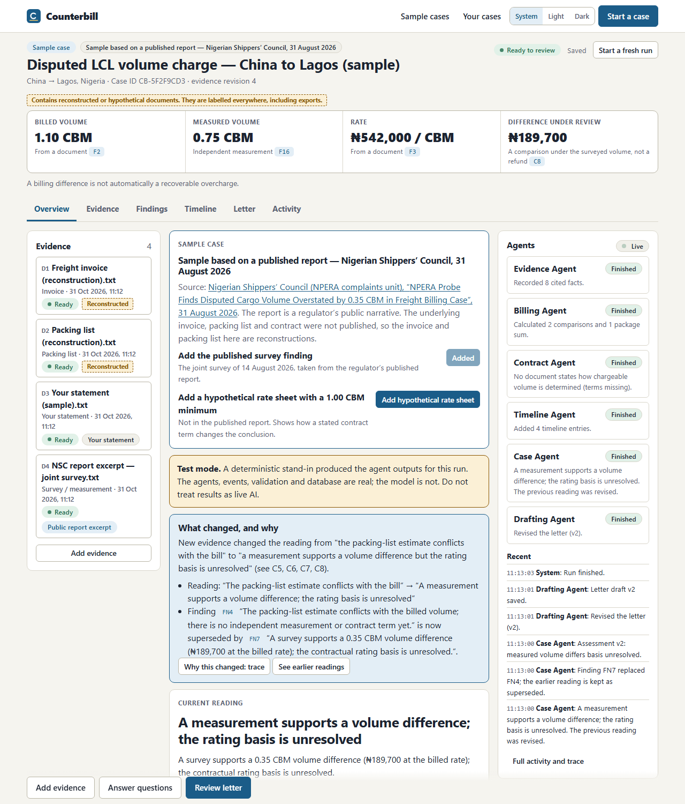
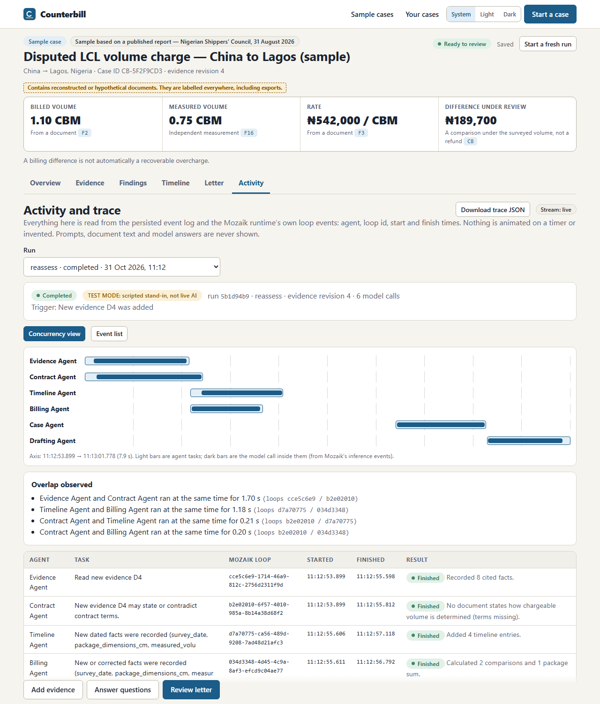
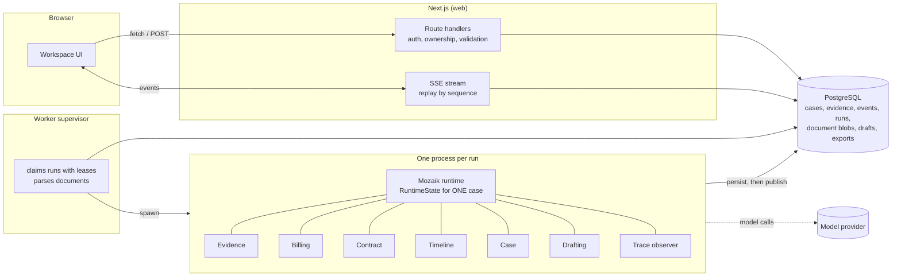
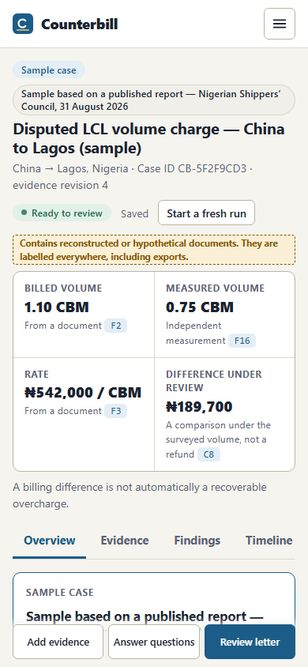
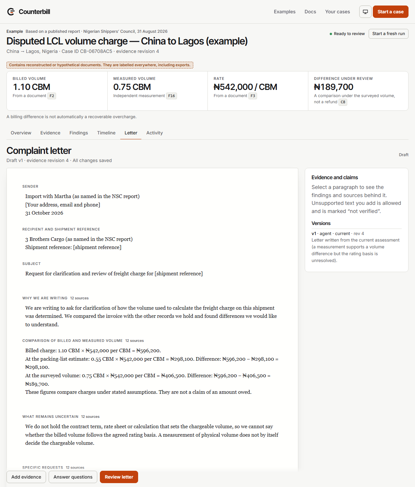

# Counterbill

**When a freight bill doesn't match the evidence, build a case you can actually send.**

Importers get freight invoices that disagree with their quote, packing list or measurements, and untangling why is slow and
easy to get wrong. Counterbill puts six [Mozaik](https://docs.jigjoy.ai/docs/runtime) agents on the documents at the same
time. They record cited facts, recalculate the difference with exact arithmetic, look for the carrier's contractual basis,
argue against the importer's own position, and draft a non-accusatory complaint letter. **When you add a document, only the
affected agents reassess, the conclusion and the letter change, and the screen tells you what changed and why.** The old
reading is kept as "superseded".

It does not give legal advice, decide who is right, guarantee refunds, or send anything. A volume difference is shown as a
*difference under review*, never as money you are owed: declared, measured, billed and chargeable volume are different things.



> *The screenshots in this README are from the real running app in **test mode** (see Status), at 1280 px and 390 px.*

## Status: what is real, what is verified, what is not

| | State |
|---|---|
| Web app, worker, database, auth, uploads, parsing, viewer, corrections, letter editor, PDF/CSV export, dashboard, settings, data deletion | Built and exercised end to end (below). |
| Six Mozaik agents running concurrently in an isolated worker process per run, with durable events, replay and bounded retries | Built. Verified by integration tests that start **real worker processes** on real PostgreSQL. |
| **Runs against a real language model** | **Done on Google Gemini's free tier** (`gemini-3.5-flash-lite` through Mozaik): both samples, the survey revision and the contract-minimum revision. Actual results, failures found and fixed, and the saved traces are in [`docs/LIVE_RESULTS.md`](docs/LIVE_RESULTS.md). This is a small number of runs on one small model, not a benchmark. |
| Model calls in the automated tests | Either the labelled deterministic **test mode** runner (plugged into the same Mozaik runtime), a local **fake of the OpenAI Responses API**, or (opt-in, `RUN_LIVE_GEMINI=1`) the real Gemini API to prove the quota-exhausted path. The default suite makes no call to any provider. |
| Hosted deployment | **Not deployed yet.** Render Free + Neon Free is prepared (`render.yaml`, [`docs/DEPLOY_RENDER.md`](docs/DEPLOY_RENDER.md)) and the container was built and exercised locally under the Render Free limits (measured results in that file). The hosted run, survey revision, export and restart recovery have **not** been run on a hosted URL, so nothing here claims it is live. |
| Demo video | Not made. |

Everything the UI says about being "TEST MODE" is literal: in test mode a scripted stand-in produces the agent outputs, and the
UI, trace, evidence summary and exports say so. Test mode is never selected implicitly: with no key and no explicit flag,
starting an investigation returns a setup error. The same is true of the model: Counterbill never substitutes a different
model, a paid model or canned output when the configured one fails; it stops with a clear error and keeps the partial results.

## Technology stack

GitHub's language bar only counts source languages (TypeScript, CSS). The stack:

| Layer | Used |
|---|---|
| Web app | Next.js 16 (App Router, Turbopack), React 19, TypeScript 6 |
| Agents | [Mozaik](https://docs.jigjoy.ai/docs/runtime) 4.2 runtime: six concurrent agents, `runLoop`, semantic events, structured output |
| Model | Google Gemini free tier (`gemini-3.5-flash-lite`) through Mozaik's Gemini adapter; OpenAI, Anthropic and DeepSeek adapters are wired but only Gemini was run for real |
| Data | PostgreSQL (durable event log, work queue, files as `bytea`), `pg`; embedded PostgreSQL for local development |
| Validation | Zod 4 for every model output, API body and event; exact-decimal arithmetic in `src/domain` |
| Documents | `unpdf` text extraction, `pdf-lib` + Noto Sans for the exports |
| Interface | Plain CSS design tokens, Inter Tight and Inter (self-hosted variable fonts), GSAP 3 for public-page motion |
| Tests | Vitest (unit, integration with real worker processes), Playwright + axe-core (browser, accessibility) |
| Hosting | Docker image; Render Free web service + Neon Free PostgreSQL |
| CI | GitHub Actions (`.github/workflows/ci.yml`): typecheck, lint, unit, integration, browser, image build. Committed, not yet observed running on GitHub |

## The sample case (and how truthful it is)

The primary sample is built from the Nigerian Shippers' Council report of 31 August 2026 about a six-package LCL shipment
(billed 1.10 CBM, packing-list estimate 0.55 CBM, surveyed 0.75 CBM, ₦542,000/CBM → ₦596,200 billed vs ₦406,500 at the
survey volume, ₦189,700 difference; the rating basis was not established). I read both cited reports from the live pages and
re-derived the arithmetic. **Read [`docs/SOURCE_VERIFICATION.md`](docs/SOURCE_VERIFICATION.md)**: it lists what matched the PRD,
what the report does not say, and what could not be verified (including a third "demurrage" sample that has no source, so it is not shipped).

- The invoice and packing list are **not published**; they are reconstructions and carry the label *"Reconstructed for demonstration; not an original invoice"* in the document list, the viewer, the findings, the letter annex and both PDFs.
- The survey document is a short source-derived excerpt of the report, labelled as such, with a link.
- An optional second step adds a **hypothetical rate sheet with a 1.00 CBM minimum**. It is *not* in the report, is labelled "Hypothetical illustration", and exists only to show how a stated term changes the analysis (the case moves to "a stated contract term may explain the billed volume; ₦54,200 remains unexplained").

## Quick start (local)

Prerequisites: Node 22 (20 also works) and pnpm 11 (`corepack enable` picks the pinned version). No Docker needed. Windows, macOS and Linux are supported for local development.

```bash
pnpm install
cp .env.example .env            # then put your Gemini key in .env (see "Gemini free tier" below)
pnpm db:start                   # embedded PostgreSQL on :54329 (leave running; or `docker compose up -d postgres`)
pnpm db:migrate                 # in a second terminal
pnpm dev                        # web on :3000 + worker supervisor
```

Open http://localhost:3000 → **Explore an example** → **Start this example**. `pnpm demo:check` reports, without calling a model, whether this machine is ready and in which mode.

### Gemini free tier (the configuration this project was run with)

No payment is needed. **Where your key goes (privately):** in the file **`.env` in the project root**, as one line, with an
upper-case name and no quotes or spaces:

```
GEMINI_API_KEY=your-key-here
```

- Get a key at https://aistudio.google.com/apikey (free tier; do not enable billing).
- `.env` is git-ignored (see `.gitignore`); never paste the key into any other file, a commit, an issue or a chat. Do not put it in a `NEXT_PUBLIC_*` variable.
- After editing `.env`, **restart `pnpm dev`**: the worker process reads it at start. If you saved it in lower case (`gemini_api_key=`) it still works: Counterbill maps it to the upper-case name the Gemini SDK reads.
- Keep `COUNTERBILL_INFERENCE=test` **out** of `.env`; that variable switches to the labelled scripted stand-in.

**Choose a model your free tier actually serves** (access differs per account and per model; do not assume):

```bash
pnpm gemini:models     # sends each Mozaik-supported Gemini model a one-word request and reports usable / no free quota
```

For the author's key (31 October 2026): `gemini-3.5-flash-lite` usable (≈1 s, **the default**), `gemini-3.5-flash` usable (≈4–15 s),
`gemini-3.8-flash` slow and intermittently HTTP 503, `gemini-3.1-pro-preview` **no free-tier quota** (HTTP 429, retry in ~21 h).
Mozaik 4.2.0 supports exactly those four Gemini models; set the one you choose as `MOZAIK_MODEL`.

**Free-tier limits.** Counterbill paces model calls (`MODEL_REQUESTS_PER_MINUTE`, default 10; the agent loops still run
concurrently, only calls beyond the window wait their turn). On HTTP 429 or 5xx it retries a bounded number of times
(`MODEL_MAX_RETRIES`, default 3), waiting the delay the provider asks for, never longer than `MODEL_MAX_WAIT_SECONDS` (75). A
longer retry delay, such as a daily quota, is reported immediately as *"quota exhausted … will not switch models for you"* and
the run stops with its partial results. The Activity tab shows each wait. There is no fallback to another model, a paid
model or fake output. Run `pnpm live:check volume-dispute-aug-2026 survey rate-sheet` (with `pnpm dev` running) to reproduce
the recorded investigation against your own key.

Other providers supported by Mozaik work with the same code (`OPENAI_API_KEY` / `ANTHROPIC_API_KEY` plus the matching
`MOZAIK_MODEL`), but only Gemini has been run for real here. Keys are server-side only: never sent to the browser, stored, put in a trace or logged.

### Environment

| Variable | Purpose |
|---|---|
| `DATABASE_URL` | PostgreSQL 15+. Default points at the embedded dev database. |
| `GEMINI_API_KEY` | Your Gemini free-tier key (the credential variable Mozaik's Gemini adapter reads). |
| `MOZAIK_MODEL` | Default `gemini-3.5-flash-lite`. Must be one of the four Gemini models Mozaik 4.2.0 supports and that your tier serves (`pnpm gemini:models`). `MOZAIK_REASONING_EFFORT` (default `low` for Gemini). |
| `MODEL_REQUESTS_PER_MINUTE`, `MODEL_MAX_RETRIES`, `MODEL_MAX_WAIT_SECONDS`, `MAX_TASK_ATTEMPTS` | Free-tier pacing and bounded retries (defaults 10 / 3 / 75 / 3). |
| `OPENAI_API_KEY` / `ANTHROPIC_API_KEY` | Only if you switch `MOZAIK_MODEL` to another provider's model. |
| `COUNTERBILL_INFERENCE=test` | Explicit, labelled deterministic mode for CI and offline checks. Leave unset for real runs. |
| `PUBLIC_APP_URL`, `SESSION_SECRET` | Public origin and cookie secret (set a long random secret in production). |
| `MAX_CASE_DOCUMENTS`, `MAX_FILE_MB`, `MAX_CASE_MB` | Upload limits (defaults 10 / 15 / 50). |
| `MAX_AGENT_REVISIONS`, `MAX_MODEL_CALLS_PER_RUN`, `AGENT_TASK_TIMEOUT_MS` | Per-run bounds on agent passes (default 4), model calls (40) and a single task (300 s). |
| `MAX_CONCURRENT_RUNS`, `DEMO_RUNS_PER_IP_PER_HOUR` | Worker concurrency; sample-run rate limit (bounds model spend on a public deployment). |

## Reproduce the key moment

1. Open **Examples → Start this example**. Four agent rows start at once; the **Activity** tab → *Concurrency view* shows their recorded start/finish times and the overlap between them.
2. The first reading: *"The packing-list estimate conflicts with the bill"*, difference ₦298,100 against a **shipper's estimate** (a comparison, not a measurement). Billing first reports its inputs as missing because it does not wait for Evidence; it recalculates when Evidence records the facts.
3. Click **Add published survey finding**. Evidence, then Billing, Contract, Timeline wake on events; the Case Agent revises: *"A survey supports a 0.35 CBM volume difference (₦189,700 at the billed rate); the contractual rating basis is unresolved."* A banner lists what changed, the earlier finding appears as **superseded**, and the letter is revised.
4. Click a citation chip (e.g. `D4-p1-s5`): the document opens at the highlighted passage.
5. **Letter** tab: edit a paragraph. Edits are saved, marked *not verified by Counterbill*, and never overwritten; later agent revisions to that paragraph arrive as a proposal with *Accept proposed update / Keep my wording*.
6. Tick the review acknowledgement → **Download PDF** / **Download evidence summary**.



## How it works



Long-running work never happens in a request handler. A request writes intent to PostgreSQL (a queued run, a queued document);
the **supervisor** (`workers/supervisor.ts`) parses documents and claims queued runs under a lease (at most one running run per
case, enforced by a partial unique index) and spawns **one child process per run** (`workers/run-child.ts`). That process calls
Mozaik's `initializeRuntime` exactly once, so a case's `RuntimeState` is never shared with another case. A run whose worker
disappears is failed with a recovery message and can be retried.

### Agents

| Agent | Reads | Produces | Source |
|---|---|---|---|
| Evidence | Documents, user statements | Facts with span citations and verbatim quotes | `src/mozaik/agents/evidence.ts` |
| Billing | Facts | *Which* comparisons to make (code computes the amounts), missing variables | `agents/billing.ts`, `src/domain/case-rules.ts` |
| Contract | Documents, facts | Cited clauses, or "terms missing"; questions for the carrier; challenges | `agents/contract.ts` |
| Timeline | Documents, dated facts | Cited events, gaps, conflicts (never invents dates) | `agents/timeline.ts` |
| Case | Everything above | Assessment, findings (revisions supersede), questions; looks for the strongest contrary explanation | `agents/case.ts` |
| Drafting | Assessment | Letter body; proposals instead of overwriting user edits | `agents/drafting.ts`, `src/domain/letter.ts` |

### Exact concurrency mechanism

- `src/mozaik/runtime.ts`: `defineRuntime<CounterbillState>()`; `src/mozaik/state.ts`: `CounterbillState extends RuntimeState`.
- `src/mozaik/orchestrator.ts`: joins the six agents, a coordinator and a trace observer, then `sendEvent`s `case.started` (or `evidence.added` for a reassessment).
- `src/mozaik/handlers.ts`: each agent has `SituationHandler`s (`SituationSpecification` on the event type); the processor enqueues a task and returns. `src/mozaik/tasks.ts` calls `runLoop(agentId, message, { model, context, tools, structuredOutput })` with a **fresh bounded `ModelContext` per task**. `runLoop` returns immediately, so four loops with four `loopId`s overlap. Each role's own work is serialised, different roles overlap.
- Agents react to each other through `sendEvent`: `fact.recorded` → Billing (and, for dated facts, Timeline); `contract.interpretation` → Billing and Case; `calculation.completed` → Case; `assessment.updated` → Drafting. Event types and payload schemas: `src/domain/schemas.ts`.
- **Persist, then publish**: `src/mozaik/events.ts` writes each event to `case_events` (unique idempotency key) and only then calls `sendEvent`. Duplicates are dropped and counted. The browser stream (`/api/cases/:id/events`) reads the same table, so what the UI shows is what agents reacted to.
- **No stale overwrite**: every result is committed in a transaction that first locks the case row and compares the evidence revision; an older result is discarded with an event. New evidence cancels the now-obsolete run.
- **Bounded**: up to three attempts per task (`MAX_TASK_ATTEMPTS`) (validation errors are fed back), `MAX_AGENT_REVISIONS` passes per agent per run, `MAX_MODEL_CALLS_PER_RUN`, a per-call timeout, and a Case-Agent debounce of 1.8 s (a documented, intentional stabilisation window).
- **Failure capture**: Mozaik's `runLoop` is fire-and-forget and does not surface a failed model call, so `src/mozaik/instrumented-runner.ts` wraps the inference runner to report failures and enforce the budget. Mozaik Cloud telemetry is disabled in workers.
- **Trace**: `src/mozaik/trace.ts` subscribes to Mozaik's own `message_received.started`, `inference.started/completed`, `function_call.*`, `model.answer` events and stores a sanitised record (no prompts, text or answers).

### Defences that do not depend on the model behaving

| Risk | Control (and where) |
|---|---|
| Invented citations | Every cited id must exist; every quote must occur verbatim in the cited span; otherwise the output is rejected and retried (`src/domain/citations.ts`) |
| Arithmetic in prose | Models never calculate. Any ₦ or CBM figure in model prose that is not in a stored fact or calculation rejects the output (`allowedFigures`) |
| Accusations, entitlement, threats | Pattern gate on findings and the letter (`forbiddenLanguage`) |
| Prompt injection in documents | Documents are quoted data; the agent instructions say so; outputs are schema-, citation-, number- and language-validated; tested with a model stand-in that obeys the injected instruction (it is rejected) |
| Cross-case leakage | One process and one `RuntimeState` per run; every API call checks ownership (404 for others); tested |
| Secrets | Server-side only; never stored in events or traces; tested |

### Routes

Public: `/`, `/examples`, `/examples/[slug]` (sources, disclosure, launch), `/examples/[slug]/[caseId]/[tab]` (your own copy of an example, as a workspace), `/docs` (user guide and technical internals, deep-linkable), `/login`, `/signup`. The old `/demo/...` URLs redirect permanently to `/examples/...`.
Signed in: `/app`, `/app/new`, `/app/cases/[id]/[evidence|findings|timeline|letter|activity]`, `/app/settings`.
API (typed errors `{code, message, retryable}`): `/api/cases`, `/api/cases/:id` (+ `documents`, `facts`, `start`, `reassess`, `retry`, `cancel`, `findings/:ref/challenge`, `questions/:ref/answer`, `letter`, `letter/reconcile`, `exports`, `events` (SSE), `trace`), `/api/demo/cases`, `/api/demo/cases/:slug/run`, `/api/demo/runs/:runId/{events,trace}`, `/api/auth/*`, `/api/account`, `/api/health`.

## Trace evidence (a real Gemini run)

From [`docs/traces/live-gemini-volume-dispute-final.json`](docs/traces/live-gemini-volume-dispute-final.json), taken from `/api/cases/:id/trace` after a real run on `gemini-3.5-flash-lite` (UTC, 31 October 2026). A trace records Mozaik's own runtime events, timings, token counts, tool calls and validation outcomes. **It does not include prompts, document text or the model's answers**; what the model produced is visible as the stored facts, findings, calculations and letter, each with its citations.

```
first wave, one case.started event          loop start     inference started   finished
evidence   10:01:38.466                      -> 10:01:42.839   (inference 10:01:38.833 .. 10:01:42.793)
contract   10:01:38.467                      -> 10:01:40.824   (inference 10:01:38.836 .. 10:01:40.791)
timeline   10:01:38.467                      -> 10:01:40.355   (inference 10:01:38.757 .. 10:01:40.204)
billing    10:01:38.482                      -> 10:01:40.559   (inference 10:01:38.767 .. 10:01:40.246)
```

The four first-wave agents started within 16 ms of each other and their model calls overlapped. A later `case` pass failed validation, was retried with the reasons fed back, and then completed (`case 10:01:42.650 failed`, then `10:01:44.936 completed`): the retry is real and visible. The test-mode example trace (`docs/trace-example-test-mode.json`) is kept only to show the event shapes without a provider.




## Tests and results

Run on 31 October 2026 on the development machine (Windows 11, Node 24, PostgreSQL 18 embedded). Commands and outcomes are in
[`docs/TEST_RESULTS.md`](docs/TEST_RESULTS.md).

| Command | What it covers | Model |
|---|---|---|
| `pnpm typecheck && pnpm lint` | TypeScript 6, ESLint (Next + TS) | n/a |
| `pnpm test` | Decimal/CBM arithmetic, units, rounding, minimums, currency mismatch, citation validation, prose gates, letter merge, uploads, schemas | n/a |
| `pnpm test:integration` | Real worker processes + real Mozaik runtime + PostgreSQL: concurrency, survey → revision → letter, duplicate delivery, targeted wake-ups, contract minimum, correction provenance, malformed/invalid-citation output, injection, failure/partial/retry, stale results, cancellation, crashed worker, missing credentials, PDF content, live provider path | **Test mode** or **fake provider** |
| `RUN_LIVE_GEMINI=1 pnpm exec vitest run tests/integration/live-gemini.test.ts` | Opt-in, real Gemini API: a model with no free quota fails fast with a clear error, bounded calls, no fallback | **Real Gemini** (free tier) |
| `pnpm live:check <sample> [steps]` | Not a test: runs a sample through the running app against your real key and saves the trace (how `docs/LIVE_RESULTS.md` was produced) | **Real Gemini** (free tier) |
| `pnpm test:e2e` | Browser: example journey → PDF, private case upload/correct/export, second account isolation, SSE interruption, refresh, offline source site, 6 viewport widths, keyboard, themes, reduced motion; plus `visual.spec.ts`: computed fonts, widths at 100% zoom, axe (WCAG 2 A/AA incl. colour contrast) in light and dark on public, signed-in and workspace pages, footer links, FAQ/theme/mobile menus | **Test mode** |

Integration and e2e tests need `pnpm db:start` running (they use the `counterbill_test` database).
`pnpm demo:check` checks readiness without calling a model; `pnpm gemini:models` makes one-word requests to find which Gemini models your free tier serves.

## Evidence provenance

Every fact stores its document, page/span, extraction method, provenance (`extracted`, `user_statement`, `user_correction`) and source class (`primary_document`, `official_public_report`, `reconstructed_demo`, `hypothetical_demo`, `user_statement`). Corrections never overwrite: a new user-corrected fact supersedes the extraction, which stays in the history and in the evidence summary. Uploaded originals are immutable and never included in exports.

## Known limitations

- **Real-model evidence is thin**: a handful of runs of one small free-tier model (`gemini-3.5-flash-lite`) on two reconstructed samples (see [`docs/LIVE_RESULTS.md`](docs/LIVE_RESULTS.md)). Real extraction accuracy on real customer documents is unmeasured; the PRD's accuracy benchmark (facts correct out of a hand-checked denominator) was **not** produced and no accuracy figure is claimed. On that model, answers were sometimes rejected by the validation gates and retried (the counts are recorded); a busier or weaker model can end a run with failed agents and "needs input".
- **No tool calling on Gemini**: Mozaik 4.2.0's Gemini adapter drops the `thoughtSignature` that Gemini 3 requires on function calls, so the tools are not offered to Gemini models (all arithmetic is deterministic server code regardless).
- **Free-tier limits are real**: a 429 was hit and handled live (bounded retry with the provider's own delay), but a daily quota ends a run with partial results and a clear message; there is deliberately no fallback to another or paid model. The pacing window is a fixed minute shared by all runs of the key, so a burst across a window boundary can still draw a 429.
- No OCR: images and scanned PDFs need figures typed in (recorded as user statements).
- Document storage is PostgreSQL `bytea` (fine for ≤15 MB files); no Supabase/S3 driver, no row-level security (isolation is enforced and tested in the API layer).
- Agent outputs depend on the model following the schemas; the validation gates reject bad output but cannot make a weak model good. A bad model produces failed agents and "needs input", not silent errors.
- Sample 3 (demurrage) is absent for lack of a verifiable source. Exports are PDF + CSV (no ZIP/XLSX). No shareable read-only link. No analytics.
- The browser tests and screenshots run against a production build on the development machine. The container was exercised behind a local reverse proxy (see `docs/DEPLOY_RENDER.md`); nothing has run on a hosted URL yet.

## Hosting

Needs: PostgreSQL, one long-running process that runs both the web app and the worker, outbound HTTPS to the model provider, and a proxy that does not buffer server-sent events (`X-Accel-Buffering: no` is set). Serverless platforms that kill background processes cannot run the worker.

The prepared target is **Render Free (one Web Service, Docker) + Neon Free PostgreSQL**. [`docs/DEPLOY_RENDER.md`](docs/DEPLOY_RENDER.md) has the exact steps, the measurements from running the image under the Render Free limits, and the checklist for the hosted run. Variables: `DATABASE_URL`, `PUBLIC_APP_URL`, `GEMINI_API_KEY`, `SESSION_SECRET` are secrets set in the host's dashboard, never in git; `COUNTERBILL_INFERENCE` must stay unset (a production build refuses test mode).

Health: `/api/health` is liveness (200 while the database answers; the body says whether the app is actually ready and why not). `/api/ready` is strict: 503 unless the database, a worker heartbeat from the last 15 s and a model credential are all present.

## Repository map

`src/domain` (arithmetic, rules, citations, letter, schemas) · `src/mozaik` (runtime, agents, events, tasks, trace, test runner) · `src/db` (schema access) · `src/server` (auth, access, runs, documents, demo) · `src/docs` (upload validation/parsing) · `src/exports` (PDFs) · `src/app`, `src/components` (UI + API) · `workers/` · `db/migrations` · `fixtures/` (labelled samples) · `tests/` · `docs/` (`SOURCE_VERIFICATION`, `DECISIONS`, `DEPLOY_RENDER`, `FRONTEND_REDESIGN`, `LIVE_RESULTS`, `TEST_RESULTS`, `SUBMISSION`, `traces/`).
